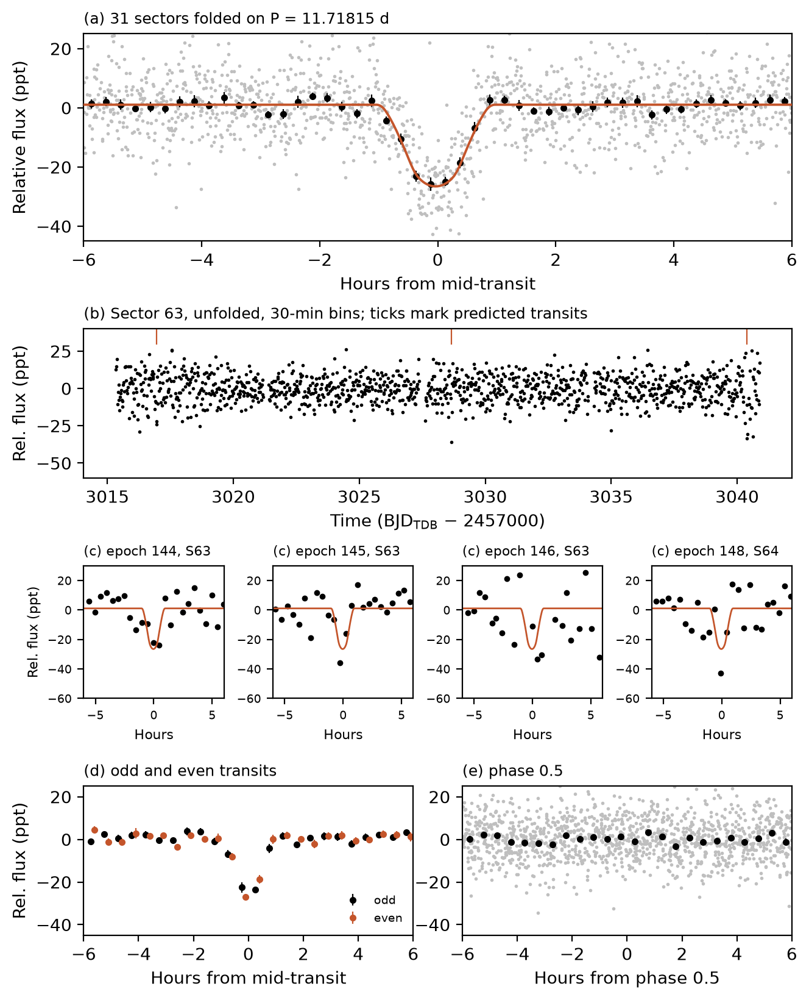

# A 2.7 Earth-radius Planet Candidate in the Habitable Zone of the M Dwarf TIC 38699429

Advait Paliwal
Independent researcher, Sterling Heights, MI 48314, USA
advaitpaliwal@gmail.com

## Abstract

I report a transit-like signal on TIC 38699429, an M dwarf at 57.5 pc in the TESS southern continuous viewing zone, found in a search of 3,883 nearby red dwarfs. TESS-SPOC photometry from 31 sectors spanning 2018–2023 shows 60 transits with a period of 11.71810 ± 0.00046 d, a depth of 22,130 ± 750 ppm and a duration of 1.47 h. A transit fit with a stellar-density prior gives a radius of 2.72 (+0.13/−0.12) R⊕, and the star's insolation at that orbit is 0.66 ± 0.15 S⊕. Odd and even depths agree, there is no secondary eclipse, and difference images rule out all 25 Gaia stars within 150″ brighter than G = 20.5. With no neighbours removed, TRICERATOPS gives FPP = 0.064 ± 0.007. The star is not a TOI. I make no validation claim; high-resolution imaging is the next step.

## Star and search

TIC 38699429 (Stassun et al. 2019; Paegert et al. 2021) has T = 15.27, Teff = 2914 K, R★ = 0.166 R☉ and M★ = 0.137 M☉. Gaia DR3 gives G = 16.80, parallax 17.42 mas, RUWE 1.09 and no non-single-star solution (Gaia Collaboration et al. 2023).

I searched TESS (Ricker et al. 2015) light curves of three pools of TIC v8.2 dwarfs: stars within 100 pc with Teff = 2800–4000 K inside 12.5° of the north ecliptic pole (1,211 stars) or below ecliptic latitude −78° with logg > 4.0 (1,216 stars, including this one), each with at least eight sectors, and stars within 25 pc with Teff = 2700–4000 K outside the continuous viewing zones with at least three sectors (1,456 stars). I dropped known TOI, CTOI and planet hosts and hosts of SPOC 2-minute threshold-crossing events (TCEs). Per sector I used SPOC 2-minute PDCSAP (Jenkins et al. 2016), else TESS-SPOC PDCSAP (Caldwell et al. 2020), else QLP (Huang et al. 2020a, 2020b; Kunimoto et al. 2021) (via lightkurve; Lightkurve Collaboration et al. 2018), flattened with a wotan biweight filter with a 0.75 d window (Hippke et al. 2019) and binned to 30 minutes. I searched periods of 1–60 d (0.5–60 d within 25 pc), 1,133 stars with Transit Least Squares (Hippke & Heller 2019) and 2,750 with the GPU box search of cuvarbase (Hoffman 2022), in up to four passes. The cuvarbase threshold, 21.7, is the highest score on flux-inverted light curves of 20 pool stars. It recovered TOI-700 b, c and d, TOI-2094 b and TOI-2095 b and c.

Every peak above threshold (SDE 9 for TLS, 21.7 for cuvarbase) with at least three transits went to the flux-level tests of LEO-vetter v1.2.0 (Kunimoto et al. 2025) with its default thresholds. LEO-vetter passed four known planets and failed all 23 artifacts from an earlier hand vet. Three signals passed: TIC 350933889, an eclipsing binary with two equal eclipses per orbit; TIC 264151965, still being vetted; and TIC 38699429 (cuvarbase score 138).

## Transit fit

I fitted the 1,706 points within 0.3 d of transit with batman (Kreidberg 2015) and emcee (Foreman-Mackey et al. 2013), supersampled to 30 minutes, with a circular orbit and free quadratic limb darkening (Kipping 2013). χ² is the sum over points of the squared residual divided by the per-point scatter, 8,500 ppm (1.4826 times the out-of-transit median absolute deviation). The stellar density prior is Gaussian in log ρ★, centred on 42.0 g cm⁻³ from the TIC mass and radius (ρ★ = M★ / (4/3 π R★³)) with width 0.05 dex. The fit gives Rp/R★ = 0.150 ± 0.007, b = 0.27 (+0.16/−0.18), a/R★ = 67.4 ± 2.5, a duration of 1.47 ± 0.05 h and Rp = 2.72 (+0.13/−0.12) R⊕ with the TIC radius held fixed. Without the prior the fitted density is 36 (+14/−17) g cm⁻³, and adding the prior raises the best-fit χ² by only 0.19. Transit Least Squares gives P = 11.71810 ± 0.00046 d and T0 = 2458329.5326 BJD_TDB. SPOC data validation gives an insolation of 0.66 ± 0.15 S⊕ and Teq = 230 ± 13 K.

## Vetting

A box fit gives 22,127 ± 748 ppm (29.6σ). Odd and even transits are 22,419 ± 1,007 and 21,803 ± 1,111 ppm (0.41σ). The depth at phase 0.5 is 31 ± 799 ppm, and the strongest dip in a scan of all other phases is 3.6σ. Per-sector depths from the TESS-SPOC PDCSAP files give χ² = 39.3 for 30 degrees of freedom about their weighted mean (23,416 ppm; p = 0.12); the 2018–19, 2020–21 and 2023 depths are 21,961 ± 1,165, 23,415 ± 1,301 and 20,780 ± 1,450 ppm. TGLC PSF photometry (Han & Brandt 2023) gives 24,140 ± 1,572 ppm. The per-sector SAP/PDCSAP depth ratio tracks SPOC's crowding metric (Pearson r = 0.86).

In difference images from TESScut cutouts (Brasseur et al. 2019) in Sectors 29, 31, 63 and 64, I fitted the TESS PRF (Bell & Higgins 2022) at each Gaia DR3 position with free amplitude and offset. Δχ² is the χ² of the model at a neighbour minus that at the target, over the 15 × 15 pixel stamp, with per-pixel noise from 120 difference images at random phases. A free-position fit lands 3.7–8.4″ from the target. All 25 Gaia stars within 150″ with G < 20.5 are ruled out at summed Δχ² > 25. The brightest, TIC 38696697 (T = 14.58, 41″) and TIC 38699430 (T = 14.66, 48″), give Δχ² = 193 and 202; the nearest (G = 20.1, 18″) gives 57. Stars within about 5″ or fainter than G = 20.5 are untested.

The star is not a TOI or CTOI (ExoFOP, 2026 October 16; NASA Exoplanet Archive) or a Eumemic (2026) candidate. TESS-SPOC data validation for Sectors 56–69 reported it as a TCE (P = 11.7183 d, MES 11.9, not flagged as an eclipsing binary, radius 3.9 ± 4.7 R⊕), but it never became a TOI.

## False-positive probability

I ran TRICERATOPS v1.1.0 (Giacalone & Dressing 2020; Giacalone et al. 2021) ten times with 10⁶ draws, SPOC apertures in all 31 sectors, all 75 field stars and no contrast curve. With no neighbours removed, FPP = 0.064 ± 0.007 and NFPP = 0.039 ± 0.005. Most of the NFPP is an eclipsing binary on TIC 38696697. Following Giacalone et al. (2021, Section 2.2), who drop nearby-star scenarios ruled out by other data, I removed the 23 neighbours with Δχ² > 25 in each of the four sectors. This gives FPP = 0.026 ± 0.003 and NFPP = 0 in all ten runs. This exclusion rests on the TESS pixels, not on ground-based photometry. What remains is mainly a planet around an unresolved bound companion (0.023). Both values exceed the 0.015 validation threshold and no high-resolution imaging exists, so I make no validation claim.

## Summary

TIC 38699429.01 is a 2.7 R⊕ sub-Neptune candidate in the habitable zone of a late M dwarf. High-resolution imaging can test the bound-companion scenario, and ground-based photometry can place the 2% transit on target.

## Acknowledgments

This paper includes data collected by the TESS mission, funded by the NASA Science Mission Directorate, and obtained from MAST. It uses data from the ESA mission Gaia, processed by the Gaia DPAC.

## Figure 1

TESS-SPOC photometry of TIC 38699429. (a) All 31 sectors folded on P = 11.718154 d (grey), 15-minute bins (black) and the density-prior model (orange). (b) The unfolded, detrended Sector 63 light curve in 30-minute bins, with predicted transits marked. (c) Four single transits from Sectors 63 and 64. (d) Odd (black) and even (orange) transits in 30-minute bins. (e) The light curve at phase 0.5.

## References

Bell, K. J., & Higgins, M. E. 2022, TESS_PRF: Display the TESS pixel response function, ascl:2207.008
Brasseur, C. E., Phillip, C., Fleming, S. W., Mullally, S. E., & White, R. L. 2019, Astrocut: Tools for creating cutouts of TESS images, ascl:1905.007
Caldwell, D. A., Tenenbaum, P., Twicken, J. D., et al. 2020, RNAAS, 4, 201
Eumemic 2026, exoplanets, GitHub, commit e26c507, https://github.com/eumemic/exoplanets
Foreman-Mackey, D., Hogg, D. W., Lang, D., & Goodman, J. 2013, PASP, 125, 306
Gaia Collaboration, Vallenari, A., Brown, A. G. A., et al. 2023, A&A, 674, A1
Giacalone, S., & Dressing, C. D. 2020, triceratops, ascl:2002.004
Giacalone, S., Dressing, C. D., Jensen, E. L. N., et al. 2021, AJ, 161, 24
Han, T., & Brandt, T. D. 2023, AJ, 165, 71
Hippke, M., David, T. J., Mulders, G. D., & Heller, R. 2019, AJ, 158, 143
Hippke, M., & Heller, R. 2019, A&A, 623, A39
Hoffman, J. 2022, cuvarbase: fast period finding utilities for GPUs, ascl:2210.030
Huang, C. X., Vanderburg, A., Pál, A., et al. 2020a, RNAAS, 4, 204
Huang, C. X., Vanderburg, A., Pál, A., et al. 2020b, RNAAS, 4, 206
Jenkins, J. M., Twicken, J. D., McCauliff, S., et al. 2016, Proc. SPIE, 9913, 99133E
Kipping, D. M. 2013, MNRAS, 435, 2152
Kreidberg, L. 2015, PASP, 127, 1161
Kunimoto, M., Bryson, S., Jaffee, D., et al. 2025, AJ, 170, 280
Kunimoto, M., Huang, C., Tey, E., et al. 2021, RNAAS, 5, 234
Lightkurve Collaboration, Cardoso, J. V. de M., Hedges, C., et al. 2018, Lightkurve: Kepler and TESS time series analysis in Python, ascl:1812.013
Paegert, M., Stassun, K. G., Collins, K. A., et al. 2021, arXiv:2108.04778
Ricker, G. R., Winn, J. N., Vanderspek, R., et al. 2015, JATIS, 1, 014003
Stassun, K. G., Oelkers, R. J., Paegert, M., et al. 2019, AJ, 158, 138
